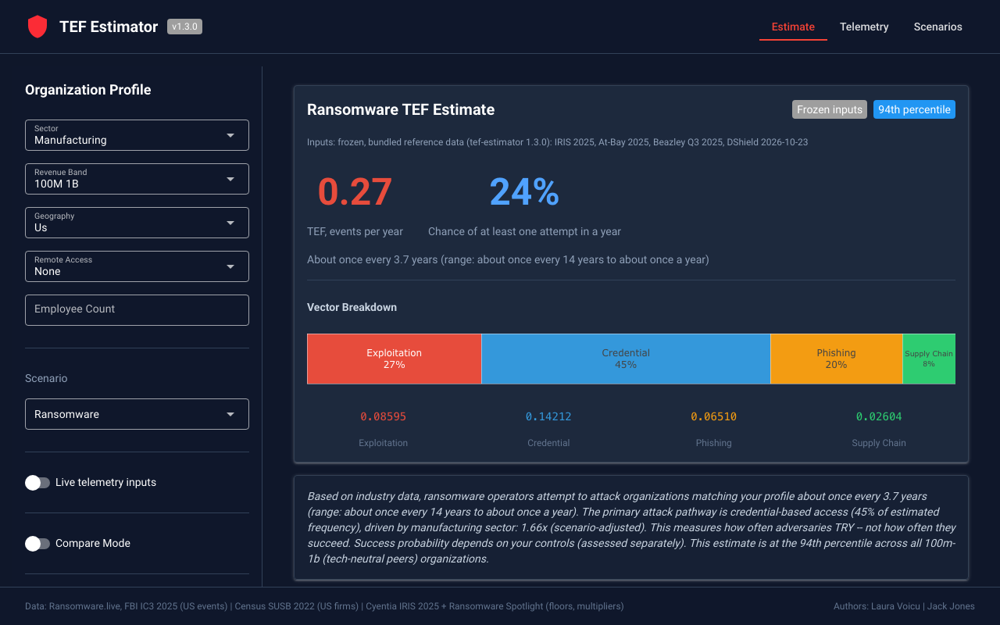
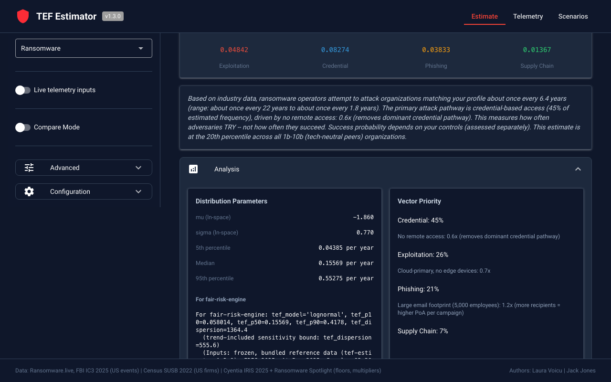
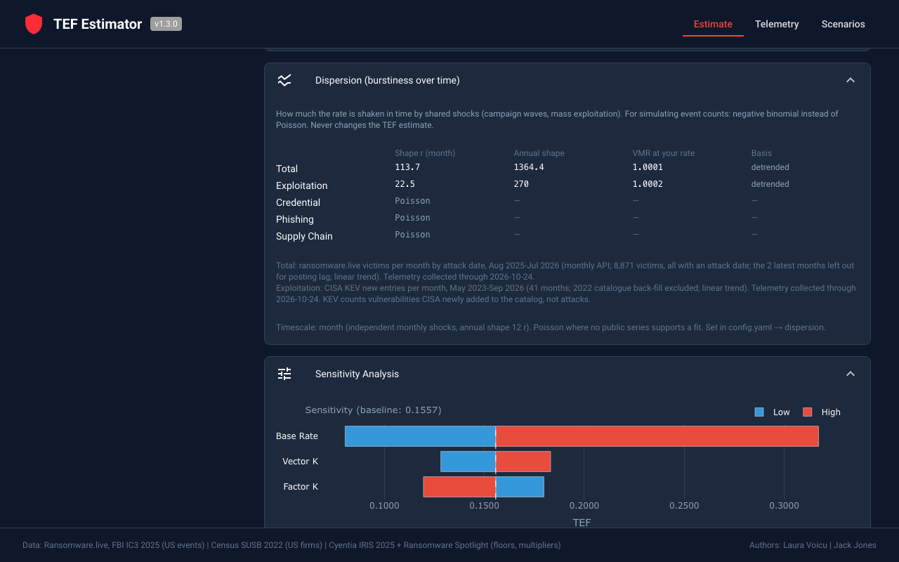
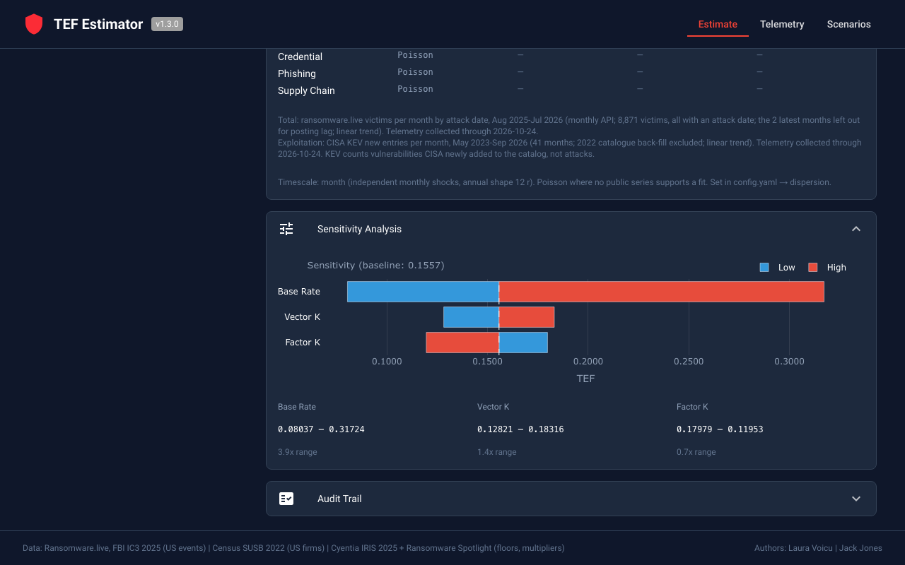
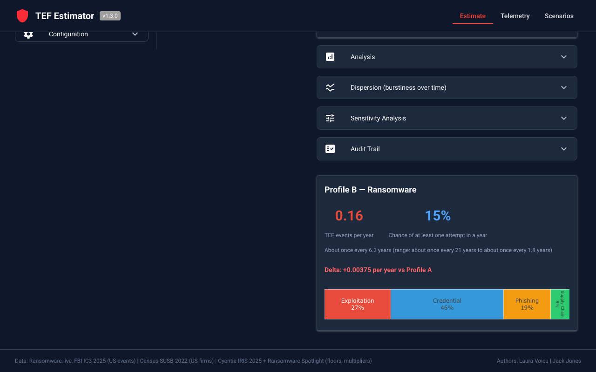
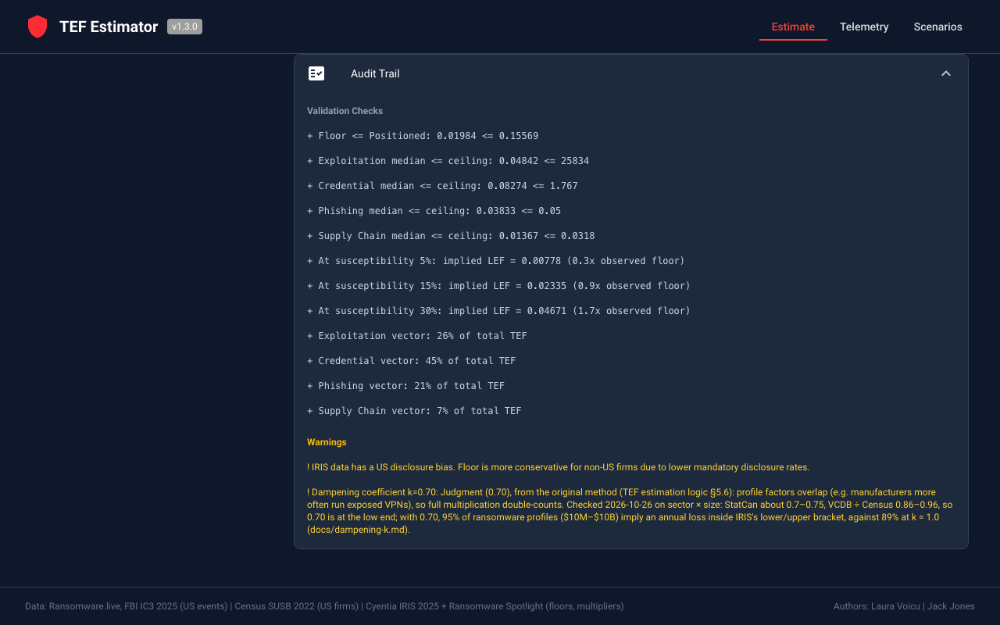

# TEF Estimator

[](https://pypi.org/project/tef-estimator/)
[](https://creativecommons.org/licenses/by-nc-sa/4.0/)
[](https://www.python.org/downloads/)
[](https://www.fairinstitute.org/)

**Important:** This is an independent implementation of TEF estimation for the FAIR methodology. See [FAIR_NOTICE.md](FAIR_NOTICE.md) for trademark information, data sources, and attributions.

Data-grounded Threat Event Frequency estimation with vector decomposition and multi-scenario support.

Decomposes threat frequency into four initial access vectors (exploitation, credential, phishing, supply chain), each with independent data sources and floor/ceiling bounds. Supports **ransomware**, **business email compromise (BEC)**, **data exfiltration**, **web application exploitation**, and **custom analyst-defined** scenarios.

Docs: [user guide](docs/user-guide.md) (usage, interpretation), [technical reference](docs/technical-reference.md) (methodology, sources), [API reference](docs/api-reference.md) (CLI, Python).

## Authors

Laura Voicu and Jack Jones.

## Web UI



Estimates with vector breakdown, analysis, sensitivity, compare mode and audit trail (NiceGUI); a badge shows whether the inputs are frozen or live.

<details>
<summary>More screenshots</summary>

**Analysis & Sensitivity**


**Dispersion panel**


**Sensitivity tornado chart**


**Compare Mode**


**Audit Trail**


</details>

## Installation

From [PyPI](https://pypi.org/project/tef-estimator/):

```bash
pip install tef-estimator
```

With optional extras:

```bash
pip install tef-estimator[ui]          # Web interface (NiceGUI)
pip install tef-estimator[telemetry]   # Continuous monitoring (requests)
pip install tef-estimator[viz]         # Charts (matplotlib, plotly)
pip install tef-estimator[all]         # Everything
```

Or from source:

```bash
git clone https://github.com/security-decision-science/security-decision-labs.git
cd security-decision-labs/tools/tef-estimator
pip install -e ".[dev]"
```

Requires Python 3.10+. All reference data ships with the package; no API keys or accounts.

## Quick Start

### Python API

```python
from tef_estimator.engine import TEFEngine
from tef_estimator.profile import OrganizationProfile
from tef_estimator.data.common import Sector, RevenueBand, Geography, RemoteAccessType
from tef_estimator.data.scenarios.ransomware import RansomwareScenario

profile = OrganizationProfile(
    sector=Sector.MANUFACTURING,
    revenue_band=RevenueBand.R_100M_1B,
    geography=Geography.US,
    remote_access=[RemoteAccessType.FORTINET],
    employee_count=2000,
)
print(TEFEngine(scenario=RansomwareScenario()).estimate(profile).brief_report())
```

### CLI and Web UI

```bash
tef-estimator estimate --sector manufacturing --revenue 100m_1b --geo us --remote-access fortinet --employees 2000
tef-estimator estimate --sector financial --revenue 100m_1b --geo us --scenario bec
tef-estimator ui        # needs pip install tef-estimator[ui]
```

All commands and flags: [API reference](docs/api-reference.md).

### Telemetry Monitoring

```bash
pip install tef-estimator[telemetry]
tef-estimator telemetry init
tef-estimator telemetry collect --force
tef-estimator telemetry baseline
tef-estimator telemetry watch --interval 60
```

Collects public threat data, flags shifts, and with `--live` feeds the dispersion shapes and the ransomware base rate ([Frozen and Live](docs/user-guide.md#telemetry-inputs-frozen-and-live)).

## How It Works

Threat frequency is split into four initial access vectors (exploitation, credential, phishing, supply chain), each with an observed floor, a sanity-check ceiling and a positioned estimate: base rate × profile multipliers, where the base rate counts observed events per US firm. How it works: [user guide](docs/user-guide.md#how-the-estimation-works); method: [technical reference](docs/technical-reference.md).

## Output Tiers

Tier 1 summary (`--brief`), Tier 2 analysis (default), Tier 3 audit (`--full`), JSON (`--json`), Markdown (`--output file.md`). See [API reference](docs/api-reference.md).

## Data Sources

Every empirical parameter loads from bundled, cited JSON under `data/reference/` and `data/scenarios/`; nothing is hardcoded in the engine. Sources and what each sets: [technical reference §5.1](docs/technical-reference.md#51-sources).

To update, replace the `extracted.json` files under `src/tef_estimator/data/reference/`. Every estimate names its source editions.

```bash
tef-estimator refresh check      # Per-source age; flags sources past their own update cycle
```

## Limitations

The base rate drives the output, and several inputs are judgment (labelled). Full list: [technical reference, Limitations](docs/technical-reference.md#limitations).

## License

Code and data in this repository are released under the Creative Commons Attribution-NonCommercial-ShareAlike 4.0 International License (CC BY-NC-SA 4.0). See [LICENSE](LICENSE) and [FAIR_NOTICE.md](FAIR_NOTICE.md).
